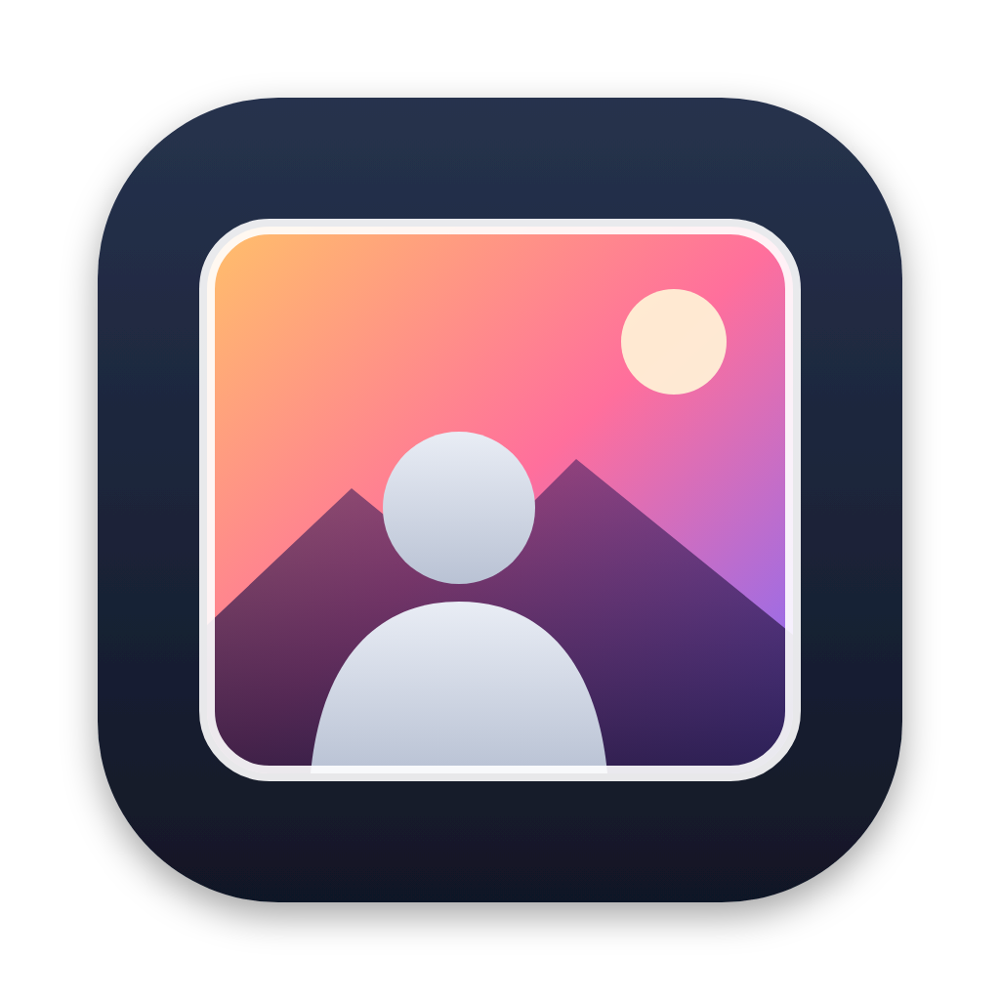
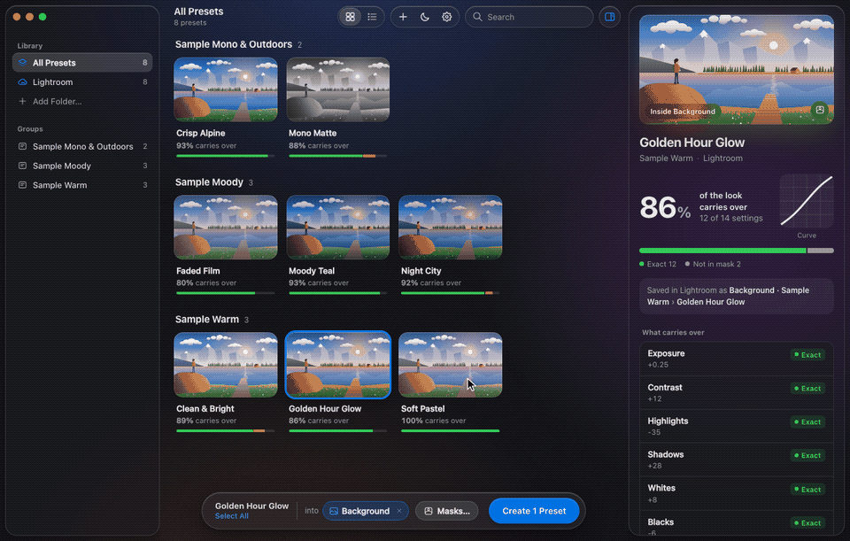
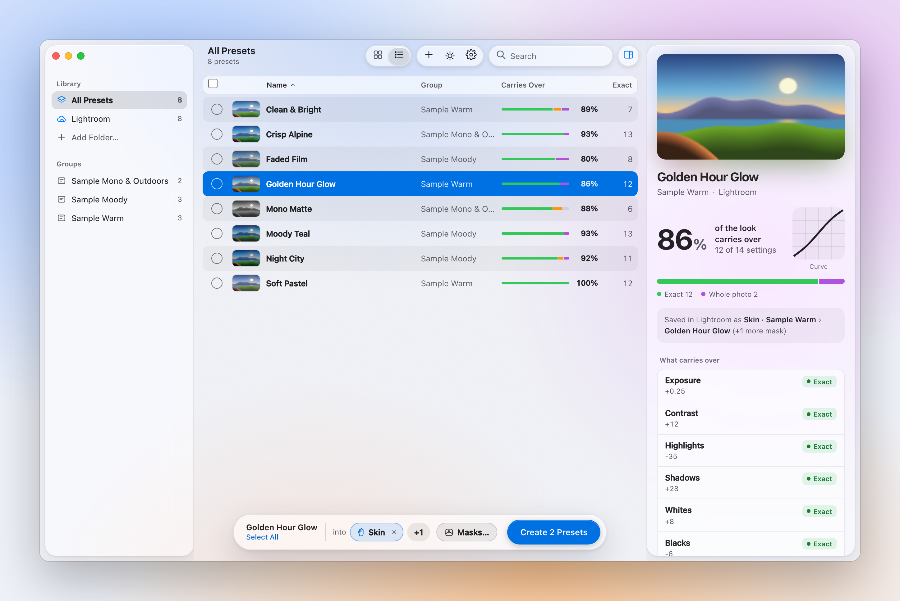
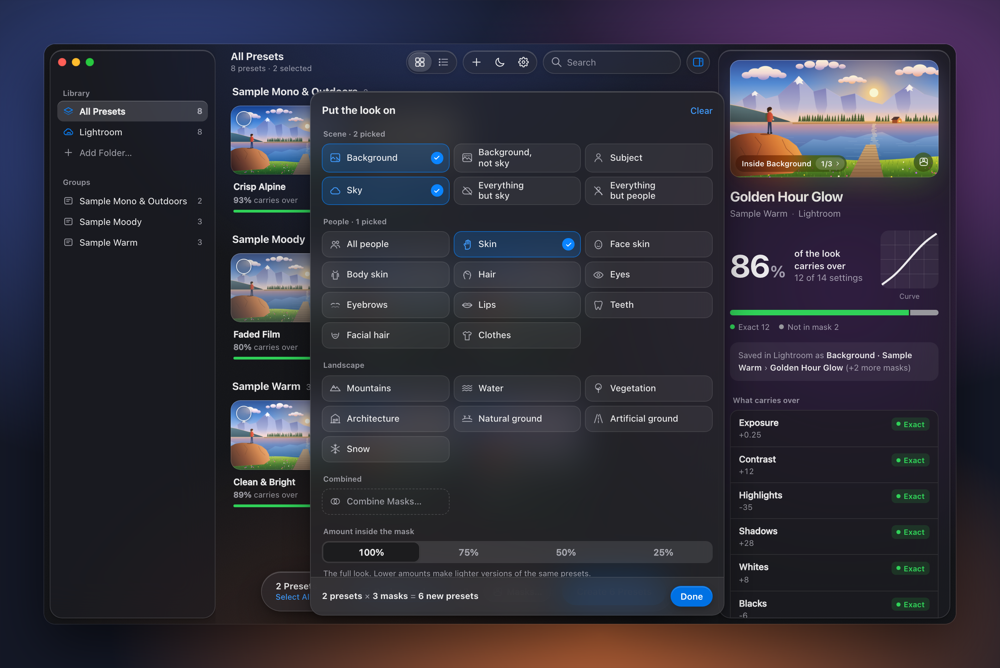
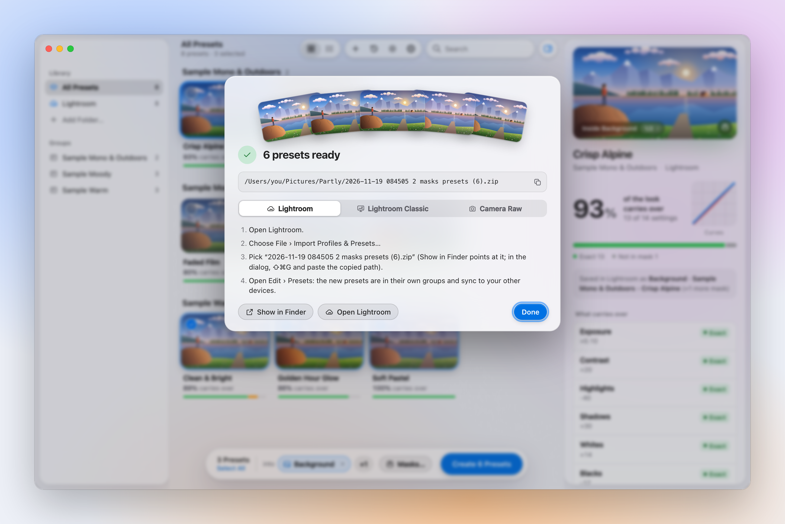

<p align="center"></p>

<h1 align="center">Partly</h1>

<p align="center"><b>Preset to Mask Converter for Lightroom</b></p>

<p align="center">
Convert any Lightroom preset into a <b>mask preset</b>: the same look on <b>just the background</b>, or just the subject,<br>
the sky, people's skin, the water… A free Mac app for Lightroom, Lightroom Classic and Camera Raw.
</p>

<p align="center"><a href="https://github.com/pvn-ptl/partly-lightroom-preset-converter/releases/latest/download/Partly.dmg"><b>⬇ Download Partly for Mac</b></a> (.dmg) · macOS 13 or later · Apple silicon and Intel · <a href="#install">How to install</a></p>

<p align="center"></p>

## Why

Lightroom presets change the whole photo. Often you want the look only behind your subject, or only on the sky.
Doing that by hand means adding a mask and copying every slider into it, for every preset you own.

Partly does the copying: it's a converter for the presets you already have. It takes the presets you already have and writes new ones that carry the same
look inside an AI mask such as **Select Background**. Apply one in Lightroom and it detects the background (or sky,
skin, water…) on that photo and puts the look only there. The new presets sync to your other devices like any
other preset.

- Works with **Lightroom** (the cloud one, a.k.a. Lightroom CC), **Lightroom Classic** and **Camera Raw**
- Finds your presets on its own, or you can point it at a folder, a few files, or a `.zip` preset pack
- **24 places to put a look**: background, subject, sky, background without the sky, everything but people,
  people, skin, hair, eyes, lips, clothes, mountains, water, vegetation, architecture, snow and more
- Shows exactly what carries over from each preset before you create anything
- Does hundreds of presets in one go and makes a single `.zip` to import
- Runs entirely on your Mac. Nothing is uploaded, and Lightroom's own files are never changed.

<picture>
  <source media="(prefers-color-scheme: dark)" srcset="docs/screenshot-dark.png">
  
</picture>

## Install

1. Download **[Partly.dmg](https://github.com/pvn-ptl/partly-lightroom-preset-converter/releases/latest/download/Partly.dmg)** (always the latest version) and open it.
2. In the window that opens, drag **Partly** onto the **Applications** folder beside it. Then eject the
   disk image.
3. Open the app from Applications. The first time, macOS will say it can't check the app for malicious software,
   because the app isn't notarized by Apple. Click **Done**, then go to **System Settings › Privacy & Security**,
   scroll down and click **Open Anyway**. (On macOS 14 and earlier you can instead right-click the app and choose
   **Open**.) You only do this once.

Needs macOS 13 or later, on Apple silicon or Intel. Every [release](../../releases) lists the SHA-256 of its
files, so you can check your download with `shasum -a 256 ~/Downloads/Partly.dmg`. There's also a
`.zip` of the app on each release, and you can build it yourself: see [Development](#development).

## Use it

1. **Pick presets.** Your presets appear as a library, grouped like in Lightroom (see [where it looks](#where-it-looks)).
   Each one is shown as a sample scene (a mountain lake with a hiker) pushed through its own settings, so you can
   tell looks apart at a glance. Switch
   between the grid and a sortable list with the buttons in the toolbar (or ⌘1 and ⌘2). Click a preset to see what
   carries over, and the scene with the look only inside the mask you chose, the way the new preset will work.
   Press and hold the picture to see it without the look; the mask button tints what the mask covers. ⌘-click, ⇧-click or the round checkboxes select several, and **Select All** takes a whole group.
   You can also drag presets, folders or `.zip` packs onto the window.
2. **Choose where the look goes.** Click **Masks…** in the floating bar and pick one or more. Each preset × each
   mask becomes one new preset. Below the masks you can:
   - **Combine Masks…**: start from one mask, then add or subtract others, like “Subject + Water − Hair”
     (see [Combined masks](#combined-masks)). Combinations stay in the picker until you delete them.
   - Set the **Amount inside the mask** (100%, 75%, 50% or 25%) for lighter versions of a look. A lighter
     version is its own preset, named like “Moody Teal (50%)”, so it sits next to the full one.

<p align="center"></p>

3. **Create.** The new presets are saved as `.xmp` files and as one `.zip`, in `~/Pictures/Partly`
   (you can change this in Settings). The clock button in the toolbar lists your **Recent Exports**: show one in
   Finder, or **Export Again** with the same presets, masks and options (handy after you've edited a preset in
   Lightroom).
4. **Import them into Lightroom** once. The app shows you how when it's done:

<p align="center"></p>

| App | How to import |
| --- | --- |
| **Lightroom** | *File › Import Profiles & Presets…*, choose the `.zip`. The presets appear under *Presets › Yours*, in groups like “Background · Moody”. |
| **Lightroom Classic** | Click **Install for Classic & Camera Raw** in the app and restart Lightroom Classic. Or in the Develop module, click **+** on the Presets panel › *Import Presets…* and choose the `.zip`. |
| **Camera Raw** (Photoshop, Bridge) | Click **Install for Classic & Camera Raw** in the app, then restart Photoshop. |

Making the same preset again gives it the same ID, so importing again updates it instead of adding a duplicate.

## What carries over

A mask can hold most of what makes a look, but not everything. The app shows this for every preset, row by row:

| | Settings |
| --- | --- |
| **Exact** | Exposure, Contrast, Highlights, Shadows, Whites, Blacks, Texture, Clarity, Dehaze, Saturation, relative Temp & Tint, the point tone curve, red/green/blue curves, Color Grading (all four wheels, blending, balance) |
| **Approximate** | Exposure beyond ±4 EV (a mask's limit); parametric curve sliders, traced as points; black & white, as a fully desaturated mask; Vibrance, folded into Saturation if you turn that on; sharpening above Lightroom's default (40), as the mask's Sharpness; luminance noise reduction, as the mask's Noise slider (turn off with **Sharpening & noise → mask**) |
| **Whole photo** (optional) | Color Mixer (HSL), profile and creative profile, vignette, grain, calibration, Kelvin white balance, sharpening below the default. Choose **Whole photo** to keep these on the whole image like the original preset, or **Leave out** so only the masked area changes. |
| **Not in mask** | Masks the original preset already had, B&W color mix, Point Color |

The numbers are converted the way Lightroom stores them in masks. For example, a preset's Contrast +20 is stored
as 0.2 in a mask, and Exposure is stored divided by 4. These scales were checked against files Lightroom wrote
itself, not guessed.

## Masks

| Scene | People | Landscape |
| --- | --- | --- |
| Background | All people | Mountains |
| Background, not sky | Skin (face + body) | Water |
| Subject | Face skin | Vegetation |
| Sky | Body skin | Architecture |
| Everything but sky | Hair | Natural ground |
| Everything but people | Eyes (iris + whites) | Artificial ground |
| | Eyebrows, Lips, Teeth | Snow |
| | Facial hair, Clothes | |

Each one is written exactly as Lightroom writes its own Select Background / Subject / Sky / People / Landscape
masks. Lightroom works out the actual mask when you apply the preset to a photo, so presets for people or
landscape parts only change photos where Lightroom finds those things.

### Combined masks

A combination starts from one mask, then adds or subtracts others, the way Lightroom's own **Add** and
**Subtract** buttons build a mask: (start + everything added) − everything subtracted. For example “Subject +
Water − Hair”, “Sky + Mountains + Water” or “All people − Clothes”. Up to six masks can be added or subtracted.
Masks that are already a subtraction (“Background, not sky”) can only be the starting mask.

**Amount** is written as the mask's own Amount, so every slider in the mask keeps its exact value and the whole
look is scaled together.

## Where it looks

The app reads (and never writes to) these places:

| Source | Folder |
| --- | --- |
| Lightroom | `~/Pictures/Lightroom Library.lrlibrary/…/cr_settings` (your synced presets) |
| Lightroom Classic & Camera Raw | `~/Library/Application Support/Adobe/CameraRaw/Settings` |
| Lightroom Classic (older) | `~/Library/Application Support/Adobe/Lightroom/Develop Presets` (`.lrtemplate`) |
| Adobe's own presets | `/Library/Application Support/Adobe/CameraRaw/Settings` (off by default; turn on in Settings) |
| Folders you add | anything you choose with **Add folder**, searched recursively, including `.zip` packs |

Presets that turn up in more than one place are shown once, and presets made by this app are hidden so they
aren't converted twice. While the app is open it watches these folders, so presets you add, change or delete in
Lightroom show up without pressing **Look for Presets Again**.

## Privacy

Everything happens on your Mac. The app makes no network requests, and the only files it writes are the new
presets: in your output folder, plus `CameraRaw/Settings/Partly` if you click **Install for Classic &
Camera Raw**.

## Other ways to run it

**In a browser.** The app's interface is a plain web page. From a copy of this repository, run
`node scripts/serve.mjs` and open <http://127.0.0.1:8765/>. You'll need to add presets yourself (a folder,
files, or a drop), and the result downloads as a `.zip`. No install, no build step; needs [Node.js](https://nodejs.org) 20 or later.

**From the command line:**

```sh
node cli/lrmask.mjs ~/Downloads/MyPresetPack.zip --mask background,sky --out ~/Desktop/masked
node cli/lrmask.mjs MyLook.xmp --mask "subject +water -hair" --amount 50
node cli/lrmask.mjs "$HOME/Library/Application Support/Adobe/CameraRaw/Settings" --dry-run   # see what carries over
node cli/lrmask.mjs --list-masks
```

Other options: `--whole-photo`, `--vibrance`, `--no-parametric`, `--no-grayscale`, `--no-detail`, `--group "{target} · {group}"`.

## Questions

**The new preset does nothing on my photo.** For masks like Sky, Water or Hair, Lightroom has to find that thing
in the photo first. Check the Masking panel: the mask is there even when it's empty.

**Why is a setting “Approximate”?** The row's note says why. The usual cause is Exposure beyond ±4 EV, which is as
far as a mask goes, or a parametric curve, which masks can't hold, so it's traced as a point curve.

**Can I change the group names?** Yes, under **More options › Lightroom group**. `{target}` and `{group}` are
filled in, so `{group} (masked)` gives “Moody (masked)”.

**Is anything sent to Adobe or anyone else?** No. See [Privacy](#privacy).

## Development

Everything is plain JavaScript (ES modules) and one Swift file, with no dependencies to install.

```
web/core/      the converter: XMP and .lrtemplate parsing, mapping, writing, zip (shared by app, web and CLI)
web/           the interface (index.html, app.js, app.css)
macos/         the Mac app: a native window around the interface (main.swift, Info.plist, icon)
cli/           command-line tool
test/          tests (node --test), including the interface in headless Chrome
scripts/       build, sample presets, icon, docs screenshots, real-library smoke test
```

| Task | Command |
| --- | --- |
| Run the tests | `npm test` (Node 20+; the browser tests run when Chrome is installed) |
| Build the Mac app | `scripts/build-mac-app.sh` → `dist/Partly.app`, `dist/Partly.dmg` and a `.zip` (needs Xcode Command Line Tools) |
| Check the built app | `dist/Partly.app/Contents/MacOS/Partly --selftest` |
| Check the disk image | `scripts/verify-dmg.sh` (mounts it read-only, checks the app, runs the self-test from the image) |
| Publish a release | `gh release create vX.Y.Z dist/Partly.dmg dist/Partly-X.Y.Z-macOS.zip`; keep the `.dmg` name so the download link above always gets the latest |
| Check against your own presets | `node scripts/smoke-real.mjs` (read-only: converts every preset to every mask in memory) |
| Regenerate screenshots & GIF | `PYTHON=/path/to/python-with-Pillow node scripts/capture-docs.mjs` |

The sample presets in `web/samples` are original looks made for this project (`node scripts/make-samples.mjs`).

Partly was called LR Mask Presets in version 1.0.0. Presets it made then are still recognised, and it keeps using
the same folders if you have them.

---

Not made by or affiliated with Adobe. Adobe, Lightroom and Photoshop are trademarks of Adobe.
